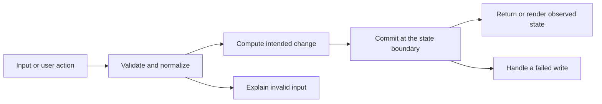

# Codebase map and reading order

[Course index](README.md)

## The problem this project solves

Nested recipe payloads could contain malformed ingredient/step values, blank edits were silently ignored, and IDs/dates were accepted by loose conversions. The improvement you will study is: A shared request boundary rejects malformed nested values and noncanonical IDs before handlers mutate rows. Recipe edits retain omitted children; valid replacements and search reindexing remain transactional. The app can be imported without binding a development port.

## Data model

Dishes own recipes. Recipes own ordered ingredients, steps and cook logs; logs can own photos. Tags and the search_index support discovery. SQLite stores relationships; photo files live separately under RECIPE_LAB_DATA/photos.

An object is a named collection of fields. An array is an ordered collection of values. An id answers “which record?”; an index answers “where is it in this array right now?” Those questions are different whenever the list can be filtered, reordered or edited. Persisted data is the form that must survive a process/page restart. Derived data can be recomputed from that persisted state.

## Trace one action

1. A React form, button or test sends a concrete operation.
2. The client serializes editable values as an HTTP request.
3. The server validates runtime input and the relevant record relationships.
4. The repository or model reads authoritative state and performs the documented change.
5. The storage boundary commits or rejects the operation.
6. The response or broadcast gives the client its observed result.

This diagram names responsibilities, not necessarily separate files. A small browser program can keep them in app.js. A larger API spreads them across controllers, services and models. Follow the actual sequence above rather than assuming every repository has the same architecture.

## Where to read first

1. [server/index.ts](../server/index.ts): locate `validatePayload` and read its inputs, branches and return/side effects.
2. [test/recipes.test.ts](../test/recipes.test.ts): read the scenario names before the helper code.
3. The root [README](../README.md): connect setup and the larger application workflow.

## Source navigation

- [server/db.ts](../server/db.ts)
- [server/index.ts](../server/index.ts)
- [server/queries.ts](../server/queries.ts)
- [server/seed.ts](../server/seed.ts)
- [shared/quantity.ts](../shared/quantity.ts)
- [shared/types.ts](../shared/types.ts)
- [src/App.tsx](../src/App.tsx)
- [src/api.ts](../src/api.ts)
- [src/components/SearchBar.tsx](../src/components/SearchBar.tsx)
- [src/components/Sheet.tsx](../src/components/Sheet.tsx)
- [src/components/TagInput.tsx](../src/components/TagInput.tsx)
- [src/components/Toast.tsx](../src/components/Toast.tsx)
- [src/components/bits.tsx](../src/components/bits.tsx)
- [src/lib/format.ts](../src/lib/format.ts)
- [src/main.tsx](../src/main.tsx)
- [src/pages/CookLogCard.tsx](../src/pages/CookLogCard.tsx)
- [src/pages/CookLogEditor.tsx](../src/pages/CookLogEditor.tsx)
- [src/pages/DishEditor.tsx](../src/pages/DishEditor.tsx)
- [src/pages/DishPage.tsx](../src/pages/DishPage.tsx)
- [src/pages/HomePage.tsx](../src/pages/HomePage.tsx)
- [src/pages/RecipeEditor.tsx](../src/pages/RecipeEditor.tsx)
- [src/pages/RecipePage.tsx](../src/pages/RecipePage.tsx)
- [vite.config.ts](../vite.config.ts)

## A practical reading technique

At each function boundary, write down the value coming in, the value going out and any side effect. A side effect includes a storage write, SQL query, network request, timer registration or DOM update. If a function calls another function, inspect only that next dependency until you can finish the chosen trace. Return to unrelated files later.

For this lesson, start with: **Create Pasta with a Weeknight recipe, one ingredient and one step. PATCH only title: both child lists remain. Send title Changed with a negative ingredient quantity: return 400 and preserve parent, children and search data. Deleting the dish cascades its recipes and removes their search entries.** Mark where the id, time, amount or other important value changes representation. For example, JSON serializes values into text; a date field may be a calendar string; SQL aggregates may return a different type from individual rows. Representation changes are common bug locations.

## Check your understanding

Without reading the solution, answer: Who owns the mutable state? Which input is untrusted? Which function first decides whether the operation is valid? What survives reload or restart? What observation would prove that the operation partially failed? Point to a source file for each answer, rather than describing a generic app from memory.
